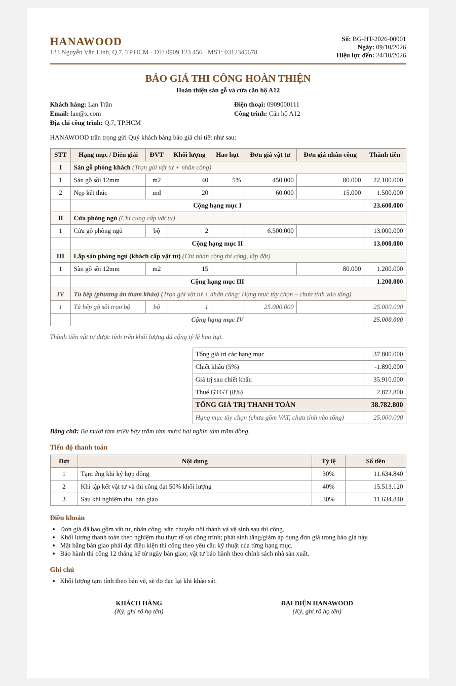

# Hệ thống Giá & Báo giá — Nghiên cứu nghiệp vụ và Thiết kế

Module này nằm trong CRM (`backend/crm/`). Mục tiêu: chuẩn hóa cách công ty nội thất gỗ / hoàn thiện công trình ra giá, ra báo giá nhanh hơn đối thủ, và **không bao giờ báo giá lỗ**.



## 1. Thực tế thị trường Việt Nam (ngành hoàn thiện, nội thất gỗ, vật liệu)

Những điểm "đau" phổ biến khi doanh nghiệp vẫn báo giá bằng Excel:

| Vấn đề | Hậu quả | Hệ thống giải quyết |
|---|---|---|
| Mỗi sales giữ một file Excel, đơn giá mỗi người một kiểu | Báo giá sai, lệch giá giữa các khách | **Bảng giá tập trung** (catalog) với 3 tầng giá |
| Quên cộng hao hụt khi báo sàn gỗ, ốp tường | Thiếu vật tư, mất lãi 5–10% | **Hao hụt mặc định theo vật tư**, tự cộng vào khối lượng vật tư |
| Giảm giá theo cảm tính để chốt | Báo giá lỗ mà không ai biết | **Giá vốn + biên lợi nhuận tối thiểu**, cảnh báo khi dưới ngưỡng |
| Sửa đi sửa lại một file, không biết bản nào đã gửi | Tranh chấp khi khách cầm bản cũ | **Phiên bản báo giá** (R1, R2...), bản đã gửi bị khóa |
| Báo giá hết hạn nhưng khách vẫn đòi giá cũ | Bị ép giá khi nguyên liệu tăng | **Hiệu lực báo giá**, không cho chốt báo giá hết hạn |
| Không biết báo giá nào đang treo, khách nào cần gọi lại | Rơi khách | Báo giá gắn với **contact + timeline**, tự chuyển stage CRM |
| Khách hỏi "chỉ mua vật tư" hoặc "chỉ thuê thợ" | Phải làm file mới | **Mỗi hạng mục chọn hình thức riêng** trong cùng báo giá |

## 2. Ba loại báo giá

| | Báo giá hoàn thiện (HT) | Báo giá vật tư (VT) | Báo giá nhà thầu (NT) |
|---|---|---|---|
| Khách hàng | Chủ nhà, chủ đầu tư nhỏ | Khách lẻ tự thi công, thợ | Nhà thầu chính, đại lý, công ty xây dựng (B2B) |
| Tầng giá vật tư | Giá bán lẻ | Giá bán lẻ | **Giá nhà thầu/đại lý** (rơi về giá lẻ nếu chưa đặt) |
| Nhân công | Có (theo hạng mục) | **Không bao giờ** | Tùy hạng mục |
| Hiệu lực mặc định | 15 ngày | 7 ngày (giá vật tư biến động nhanh) | 30 ngày |
| Tiến độ thanh toán mặc định | 30% ký HĐ · 40% thi công 50% · 30% nghiệm thu | 50% cọc · 50% trước giao | 30% cọc · 70% công nợ 30 ngày |
| Mã | `BG-HT-2026-00001` | `BG-VT-2026-00002` | `BG-NT-2026-00003` |

Lưu ý: "Báo giá nhà thầu" được hiểu là **báo giá cho nhà thầu** (B2B, giá sỉ/đại lý). Nếu cần quản lý chiều ngược lại, tức báo giá **từ** thầu phụ gửi cho công ty để so sánh, đó là module mua hàng/đấu thầu riêng, xem lộ trình bên dưới.

## 3. Nhiều hạng mục, mỗi hạng mục một kiểu báo giá

Một báo giá gồm nhiều **hạng mục** (đánh số La Mã I, II, III như hồ sơ dự toán Việt Nam). Mỗi hạng mục chọn một trong ba hình thức:

- **Trọn gói (full)**: vật tư + nhân công. Ví dụ: sàn gỗ phòng khách.
- **Chỉ vật tư (material_only)**: ví dụ khách mua cửa, tự thuê thợ lắp.
- **Chỉ nhân công (labor_only)**: khách tự cấp vật tư, công ty thi công. Hạng mục này không tính hao hụt.

Ngoài ra còn có **hạng mục tùy chọn** (`is_optional`). Nó hiện trên báo giá nhưng không cộng vào tổng, dùng để gợi ý thêm (upsell), ví dụ "Phương án tủ bếp tham khảo". Đây là kỹ thuật bán thêm rất hiệu quả: khách thấy giá trước, đến khi muốn thêm thì không phải chờ báo giá mới.

## 4. Hệ thống giá (Pricing system)

Mỗi mã vật tư/dịch vụ trong catalog có:

| Trường | Ý nghĩa |
|---|---|
| `retail_price` | Giá bán lẻ vật tư |
| `contractor_price` | Giá đại lý / nhà thầu |
| `labor_price` | Đơn giá nhân công thi công |
| `material_cost`, `labor_cost` | Giá vốn (nội bộ, **không in ra báo giá**) |
| `waste_percent` | Tỷ lệ hao hụt mặc định (sàn gỗ thường 5–8%, ốp lát 5–10%) |

Quy tắc:

1. Dòng báo giá **chụp lại (snapshot)** giá tại thời điểm báo. Sau này đổi bảng giá cũng không làm thay đổi báo giá đã gửi.
2. Sales được **ghi đè** đơn giá trên từng dòng (ví dụ giá khuyến mãi). Giá vốn vẫn được giữ để tính lãi.
3. Thứ tự tính: KL vật tư = KL × (1 + hao hụt) → thành tiền vật tư + nhân công → chiết khấu dòng → cộng hạng mục → chiết khấu tổng → VAT. Làm tròn đến đồng ở từng bước, nên các con số in ra luôn cộng khớp.
4. **Biên lợi nhuận tối thiểu** (`CRM_MIN_MARGIN_PERCENT`, mặc định 15%): báo giá nào dưới ngưỡng thì có cờ `below_min_margin` để quản lý duyệt.
5. VAT chọn được 0/5/8/10%. Mức 8% là mức giảm thuế theo chính sách từng thời kỳ, **kế toán cần xác nhận mức áp dụng cho từng mặt hàng** tại thời điểm xuất hóa đơn.

### Gợi ý chiến lược giá (góc nhìn marketing)

- **Neo giá bằng phương án**: đưa 1 hạng mục tùy chọn cao cấp bên cạnh phương án chuẩn, khách sẽ thấy phương án chuẩn "hợp lý".
- **Không giảm đơn giá, hãy tặng hạng mục**: thay vì giảm 5%, tặng nẹp/len chân tường. Biên lợi nhuận được giữ, khách vẫn thấy được lợi.
- **Hiệu lực ngắn cho vật tư** (7 ngày) tạo động lực chốt và bảo vệ khi giá gỗ nhập khẩu tăng.
- **Giá nhà thầu theo tầng khối lượng** (lộ trình): ≥ 300 m² giảm thêm, nhằm giữ chân đối tác B2B.
- Theo dõi **lý do từ chối** (`reject_reason`) để biết mình thua vì giá, vì tiến độ hay vì mẫu mã. Đây là dữ liệu vàng để điều chỉnh bảng giá.

## 5. Quy trình báo giá ↔ CRM

```
draft ──send──▶ sent ──accept──▶ accepted   (contact → customer)
  ▲               │  └─reject──▶ rejected   (lưu lý do)
  │               └─revise──▶ superseded + bản mới R1 (draft)
  └── chỉ draft mới được sửa
```

- Gửi báo giá: contact đang ở subscriber/lead/MQL sẽ tự chuyển sang **SQL**, và timeline ghi `quote_sent`.
- Khách chốt: contact chuyển sang **customer**, timeline ghi `quote_accepted`.
- Báo giá đã gửi và quá hạn sẽ có `is_expired` và **không chốt được**. Phải làm phiên bản mới với giá hiện hành.
- Báo giá bị từ chối vẫn được làm phiên bản mới (giữ nguyên trạng thái từ chối để lưu lịch sử). Mỗi phiên bản chỉ sinh được một bản kế tiếp.

## 6. API

| Method | Đường dẫn | Mô tả |
|---|---|---|
| POST / GET | `/api/crm/price-items` | Tạo / tra cứu bảng giá (lọc `category`, `q`, `active`) |
| PATCH | `/api/crm/price-items/{id}` | Cập nhật giá |
| POST | `/api/crm/quotes` | Tạo báo giá (`quote_type`: finishing / material / contractor) |
| GET | `/api/crm/quotes?status=&quote_type=&contact_id=` | Danh sách kèm tổng giá trị |
| GET / PUT | `/api/crm/quotes/{id}` | Chi tiết (gồm tổng, bằng chữ, lãi nội bộ) / sửa bản nháp |
| POST | `/api/crm/quotes/{id}/send` · `/accept` · `/reject` · `/revise` | Quy trình |
| GET | `/api/crm/quotes/{id}/print` | Bản in A4 cho khách (không lộ giá vốn) |

Ví dụ tạo báo giá hoàn thiện nhiều hạng mục:

```json
{
  "quote_type": "finishing",
  "title": "Hoàn thiện sàn gỗ và cửa căn hộ A12",
  "contact_id": 12,
  "discount_percent": "5",
  "vat_rate": 8,
  "sections": [
    {"name": "Sàn gỗ phòng khách", "lines": [
      {"price_item_id": 1, "quantity": "40"},
      {"price_item_id": 2, "quantity": "20"}]},
    {"name": "Cửa phòng ngủ", "pricing_mode": "material_only",
     "lines": [{"price_item_id": 3, "quantity": "2"}]},
    {"name": "Lắp sàn phòng ngủ (khách cấp vật tư)", "pricing_mode": "labor_only",
     "lines": [{"price_item_id": 1, "quantity": "15"}]},
    {"name": "Tủ bếp (phương án tham khảo)", "is_optional": true,
     "lines": [{"description": "Tủ bếp gỗ sồi", "unit": "bộ", "quantity": "1", "material_unit_price": 25000000}]}
  ]
}
```

Cấu hình thông tin công ty in trên báo giá: `CRM_COMPANY_NAME`, `CRM_COMPANY_ADDRESS`, `CRM_COMPANY_PHONE`, `CRM_COMPANY_EMAIL`, `CRM_COMPANY_TAX_CODE`.

## 7. Tính năng CRM "siêu hiện đại" — lộ trình đề xuất

Đã có (sprint này): bảng giá 3 tầng, 3 loại báo giá, hạng mục đa hình thức, hao hụt, chiết khấu 2 cấp, VAT, tiến độ thanh toán, bằng chữ, phiên bản, hiệu lực, cảnh báo lãi, bản in, tự động chuyển stage CRM.

Tiếp theo, theo thứ tự giá trị kinh doanh:

1. **Gửi báo giá qua Zalo/Email kèm link xem online** + theo dõi khách đã mở chưa, mở mấy lần, xem hạng mục nào lâu nhất. Khách mở lại nhiều lần là tín hiệu nóng để sales gọi ngay.
2. **Khách ký / chấp nhận online** trên link báo giá (OTP qua SĐT), không cần in, ký, chụp.
3. **Quy trình duyệt chiết khấu**: báo giá dưới biên tối thiểu bị chặn gửi cho đến khi trưởng phòng duyệt.
4. **Mẫu báo giá (template) theo loại công trình**: căn hộ 2PN, nhà phố, văn phòng. Sales chỉ cần nhập diện tích.
5. **Khảo sát hiện trường trên mobile**: đo đạc, chụp ảnh, tự sinh khối lượng vào báo giá.
6. **Báo giá → Hợp đồng → Phát sinh (change order) → Nghiệm thu → Công nợ**. Báo giá đã chốt không sửa được; mọi thay đổi đi qua phiếu phát sinh.
7. **Giá theo tầng khối lượng & bảng giá theo khu vực / thời gian** (khuyến mãi theo mùa, giá Hà Nội khác TP.HCM).
8. **Follow-up tự động**: sau 2 ngày khách chưa phản hồi thì nhắc sales; 3 ngày trước khi hết hạn thì gửi nhắc khách.
9. **Dashboard**: tỷ lệ chốt theo loại báo giá / sales / nguồn khách, giá trị pipeline, lý do thua, biên lợi nhuận thực tế.
10. **Báo giá từ thầu phụ** (chiều mua): so sánh nhiều thầu phụ cho cùng hạng mục, chọn thầu tốt nhất, tự tính giá bán = giá thầu phụ + biên.
11. **Xuất PDF / Excel** đúng mẫu công ty, và **hóa đơn điện tử** khi chốt.

## 8. Giới hạn hiện tại

- Chưa có đăng nhập/phân quyền: API `internal` (giá vốn, lãi) cần được che theo vai trò trước khi mở cho sales/đối tác.
- Bản in là HTML (in ra PDF bằng trình duyệt). Chưa có xuất PDF phía server.
- Số lượng hạng mục/dòng có giới hạn (100 hạng mục, 500 dòng/hạng mục) để tránh payload quá lớn.
